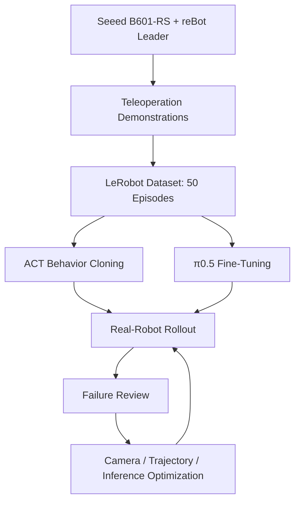

# B601-RS Battery Insertion
## Real-Robot Manipulation Portfolio | ACT → π0.5

基于 Seeed B601-RS 单臂机械臂与 Hugging Face LeRobot，完成电池抓取、移动、插槽对准与插入任务。项目覆盖遥操作示教、ACT 模仿学习、π0.5 VLA 微调、真机推理、RTC 动作衔接与实验对比。

> **项目定位：** Real-Robot Manipulation · Imitation Learning · Vision-Language-Action (VLA) · Policy Fine-Tuning · Online Inference

## 真机演示

- [观看真机演示 MP4](./assets/real-robot-demo.mp4)
- [查看 8 个操作关键帧](./assets/real-robot-demo-frames.png)

## 项目成果一览

| 项目 | 实验结果 |
|---|---|
| 机器人平台 | 1 × Seeed B601-RS Follower + 1 × reBot Arm 102 Leader |
| 示教数据 | 50 条真机 Episode，左侧 25 条、右侧 25 条 |
| 视觉输入 | Front / Side 双视角，640 × 480，30 FPS |
| ACT | 初始成功率 56%；视角与轨迹优化后 72%；启用 TE 后 80% |
| π0.5 | LoRA r32 36%；Expert-Only 52%；Full FT 76%；Full FT + RTC 92% |
| π0.5 训练 | LoRA r32、Expert-Only、Full FT 均完成 80,000 steps |
| 最高真机成功率 | π0.5 Full FT + RTC：23/25（92%） |

**评测口径：** 表中 ACT 和 π0.5 的成功率均对应 25 次真机测试。RTC 是 Full FT checkpoint 的推理策略，不是额外训练出的模型。

## 1. Task & Robot Platform

任务要求单臂机械臂根据视觉观测和机器人状态，完成电池抓取、移动、对准和插入。

| 项目 | 配置 |
|---|---|
| Follower | 1 × Seeed B601-RS |
| Leader | 1 × reBot Arm 102 |
| Robot Framework | LeRobot |
| Task | Insert the battery into slot |
| Camera Views | Front / Side |
| Image Resolution | 640 × 480 |
| Camera FPS | 30 FPS |
| ACT Control Frequency | 30 Hz |

## 2. Dataset

使用 Leader-Follower 遥操作方式采集单臂示教数据。50 条 Episode 按电池初始摆放区域均分，每 5 条示教调整一次初始位置，以覆盖同侧不同相对位置。

| Dataset | Repo ID | Episodes | Frames | Camera Views |
|---|---|---:|---:|---|
| ACT | seeed_rebot_b601_rs/test1012_2 | 50 | 29,737 | Front / Side |
| π0.5 | seeed_rebot_b601_rs/test_1102 | 50 | 32,666 | Front / Side |

| 初始摆放区域 | Episode 数量 | 占比 |
|---|---:|---:|
| 左侧 | 25 | 50% |
| 右侧 | 25 | 50% |
| **合计** | **50** | **100%** |

π0.5 数据集的任务文本为 **Insert the battery into slot**，task_index 为 0。

## 3. Real-Robot Results

### 3.1 ACT：Imitation Learning Baseline

| 实验阶段 | 改进内容 | 成功次数 | 成功率 |
|---|---|---:|---:|
| ACT 初始实验 | 初始相机视角与末端推压轨迹 | 14/25 | 56% |
| ACT 优化 | 调整腕部相机视角与末端推压轨迹 | 18/25 | 72% |
| ACT + TE | 在优化配置上启用 Temporal Ensembling | 20/25 | **80%** |

通过复盘失败案例，调整腕部相机视角和末端推压轨迹，将成功率从 56% 提升至 72%；进一步启用 Temporal Ensembling（TE）后达到 80%。

### 3.2 π0.5：VLA Fine-Tuning & Inference

四种 π0.5 训练实验均完成 80,000 steps。下表展示已完成 25 次真机评测的模型配置：

| 模型配置 | 微调 / 推理策略 | 成功次数 | 成功率 |
|---|---|---:|---:|
| π0.5 LoRA r32 | Rank = 32 | 9/25 | 36% |
| π0.5 Expert-Only | 训练 Action Expert | 13/25 | 52% |
| π0.5 Full Fine-Tuning | 全量微调 | 19/25 | 76% |
| π0.5 Full FT + RTC | Full FT checkpoint + RTC 推理 | 23/25 | **92%** |

**关键观察：**
- 在本任务和当前实验设置下，参数更新范围更大的 Full FT 获得了高于 LoRA r32 与 Expert-Only 的真机成功率。
- 在 Full FT checkpoint 上启用 Real-Time Chunking（RTC）后，成功率从 76% 提升至 92%。
- 上述结论是当前单臂电池插槽任务的实验观察，不外推为不同机器人或任务上的普遍结论。

## 4. Technical Workflow

### π0.5 Fine-Tuning Matrix

| Experiment | Trainable Scope | Rank | Training Steps | Status |
|---|---|---:|---:|---|
| LoRA r32 | LoRA adapters | 32 | 80,000 | Completed |
| Expert-Only | Action Expert | — | 80,000 | Completed |
| Full Fine-Tuning | Model trainable parameters | — | 80,000 | Completed |
| Full FT + RTC | Reuse Full FT checkpoint; inference-time RTC | — | No extra training | Evaluated |

## 5. Repository Guide

| Path | 内容 |
|---|---|
| [ACT/README.md](./ACT/README.md) | ACT 模型、数据集、训练配置、TE 与真机结果 |
| [pi0.5/README.md](./pi0.5/README.md) | π0.5 数据预处理、微调方法、训练环境与推理部署 |
| [pi0.5/EXPERIMENTS.md](./pi0.5/EXPERIMENTS.md) | 80k 训练实验台账与参数更新策略 |
| [pi0.5/EVALUATION.md](./pi0.5/EVALUATION.md) | 25 次真机评测结果、对比与分析 |
| [groot/README.md](./groot/README.md) | 后续模型适配预留目录 |
| [assets/](./assets/) | 真机演示视频、预览图和操作关键帧 |

## 6. Engineering Work

- 搭建 B601-RS 单臂 Leader-Follower 遥操作与双视角视觉采集流程。
- 采集、检查并组织 LeRobot 格式的真机示教数据。
- 完成 ACT 训练、真机部署、失败案例复盘及 TE 对照实验。
- 基于 LeRobot 完成 π0.5 的 LoRA、Expert-Only 和 Full Fine-Tuning 实验。
- 使用双 RTX 4090、BF16 与 Accelerate / PyTorch DDP 完成 π0.5 训练流程。
- 在 Full FT checkpoint 上部署 RTC，并完成真机策略对比评测。

## 7. Reproducibility Notes

本仓库提供项目说明、训练配置记录、实验结果和真机演示素材。当前仓库不直接托管 LeRobot 原始数据集与模型 checkpoint。复现实验需要准备对应数据集、π0.5 Base 权重、LeRobot 环境以及兼容的 B601-RS 真机平台。

训练命令、数据字段和模型配置以各子目录文档为准。由于不同实验的训练策略不同，复现时应分别核对 LoRA rank、Expert-Only 参数冻结范围和 Full FT 配置。

## References

- [LeRobot](https://github.com/huggingface/lerobot)
- [OpenPI](https://github.com/Physical-Intelligence/openpi)
- [π0.5 Real-Robot Fine-Tuning: Data, RTC and Evaluation](https://www.cnblogs.com/ZikangZhou/p/23390824/pi05-real-robot-finetuning-data-rtc)
