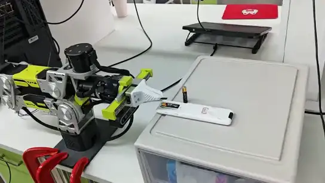
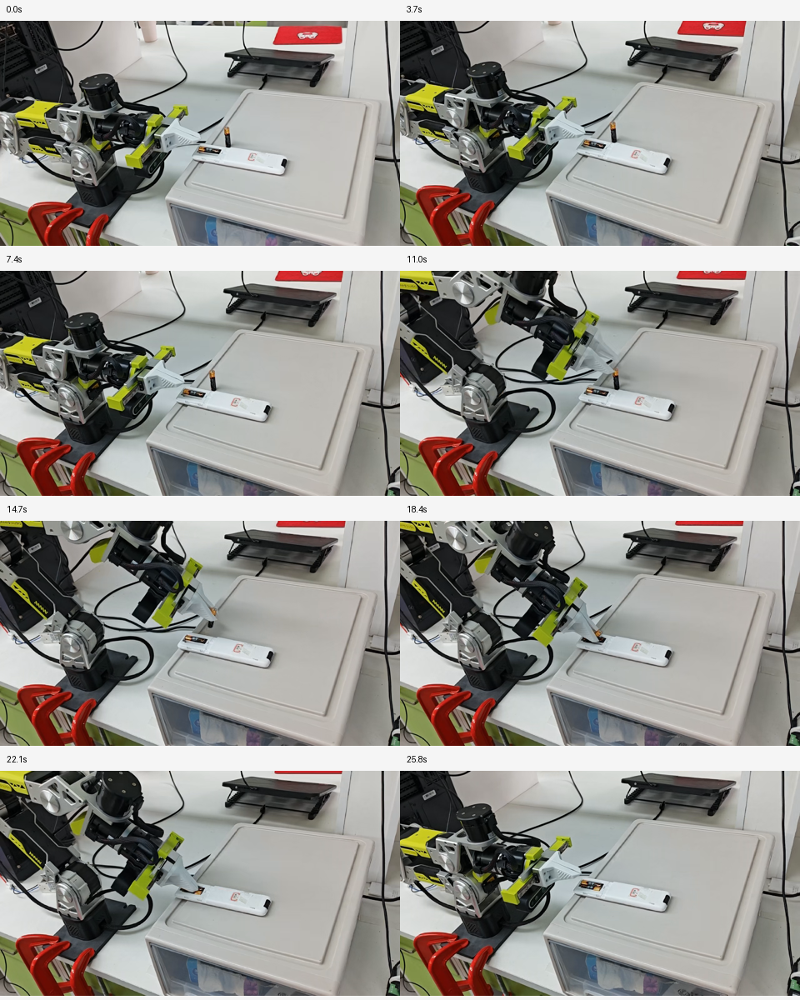

# B601-RS Battery Insertion

基于 Seeed B601-RS 单臂机械臂与 LeRobot 的真实机器人操作项目，围绕电池抓取、移动、对准和插入插槽任务，开展模仿学习与 Vision-Language-Action（VLA）策略的训练和真机部署。

## 真机演示

[](./assets/real-robot-demo.mp4)

[观看原始 MP4](./assets/real-robot-demo.mp4)

### 真机演示关键帧



## 1. Project Overview

| 项目 | 配置 |
|---|---|
| Task | Battery grasping and slot insertion |
| Follower | 1 × Seeed B601-RS |
| Leader | 1 × reBot Arm 102 |
| Framework | LeRobot |
| Research Focus | Imitation Learning、VLA Fine-Tuning、Real-Robot Evaluation |

## 2. Policy Implementations

| Policy | Directory | 内容 |
|---|---|---|
| ACT | [ACT/](./ACT/) | 单臂遥操作示教、Action Chunking、模型训练与真机部署 |
| π0.5 | [pi0.5/](./pi0.5/) | LoRA、Expert-Only、Full Fine-Tuning 与 VLA 真机适配 |
| GR00T | [groot/](./groot/) | 后续模型适配与实验记录 |

## 3. Key Real-Robot Results

当前单臂电池插槽任务的阶段性真机成功率：

| Policy / Experiment | 优化方式 | Success Rate |
|---|---|---:|
| ACT | 初始实验 | 56% |
| ACT | 调整腕部相机视角与末端推压轨迹 | 72% |
| ACT + TE | 启用 Temporal Ensembling | 80% |
| π0.5 LoRA r32 | Rank = 32 | 36% |
| π0.5 Expert-Only | 仅训练 Action Expert | 52% |
| π0.5 Full Fine-Tuning | 全参数微调 | 76% |
| π0.5 Full FT + RTC | 全参数微调并启用 RTC | **92%** |

### ACT 优化过程

通过复盘 ACT 真机失败案例，调整腕部相机视角和末端推压轨迹，成功率由 56% 提升至 72%；进一步启用 Temporal Ensembling（TE）后，成功率达到 80%。

### π0.5 微调与推理优化

π0.5 不同微调策略的真机成功率分别为：LoRA r32 36%、Expert-Only 52%、Full Fine-Tuning 76%。在 Full Fine-Tuning 模型上进一步结合 RTC，成功率达到 92%。

## 4. Research Workflow

```text
Single-Arm Robot Setup
        ↓
Teleoperation Demonstrations
        ↓
Dataset Inspection & Preprocessing
        ↓
Policy Training / Fine-Tuning
        ↓
Checkpoint Selection
        ↓
Real-Robot Rollout
        ↓
Failure Analysis & Data Iteration
```

## 4. π0.5 Dataset

| Item | Value |
|---|---|
| Dataset Repo ID | seeed_rebot_b601_rs/test_1102 |
| Episodes | 50 |
| Frames | 32,666 |
| Task Label | slot battery |
| Training Environment | Conda lerobot |
| GPU | 2 × NVIDIA RTX 4090 |

π0.5 的数据预处理、任务文本构造、训练配置和实验记录见 [π0.5 实验文档](./pi0.5/README.md) 与 [实验记录表](./pi0.5/EXPERIMENTS.md)。

## 5. Repository Structure

```text
b601rs-battery-insertion/
├── README.md
├── ACT/
│   └── README.md
├── pi0.5/
│   ├── README.md
│   └── EXPERIMENTS.md
├── groot/
│   └── README.md
├── .gitignore
└── LICENSE
```

## 6. Experiment Records

每组实验记录以下内容：

- **Robot & Task：** 机械臂型号、相机布局、控制频率和任务定义。
- **Dataset：** Repo ID、Episode 数量、Frame 数量、任务文本和数据划分。
- **Model：** Base Checkpoint、模型结构和参数更新范围。
- **Training：** GPU、精度、Batch Size、Steps、Epoch、Optimizer 和 Scheduler。
- **Inference：** Checkpoint、Action Chunk、推理频率和控制接口。
- **Evaluation：** 测试次数、成功次数、成功率、完成时间和失败阶段。

## 7. References

- [LeRobot](https://github.com/huggingface/lerobot)
- [OpenPI](https://github.com/Physical-Intelligence/openpi)
- [π0.5 Real-Robot Fine-Tuning: Data, RTC and Evaluation](https://www.cnblogs.com/ZikangZhou/p/23390824/pi05-real-robot-finetuning-data-rtc)
